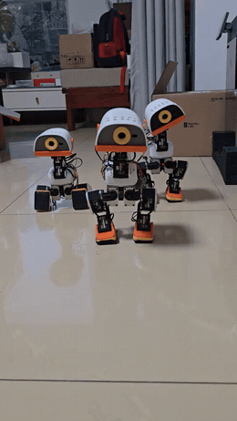
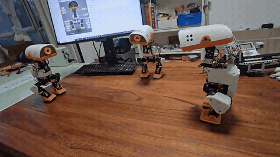
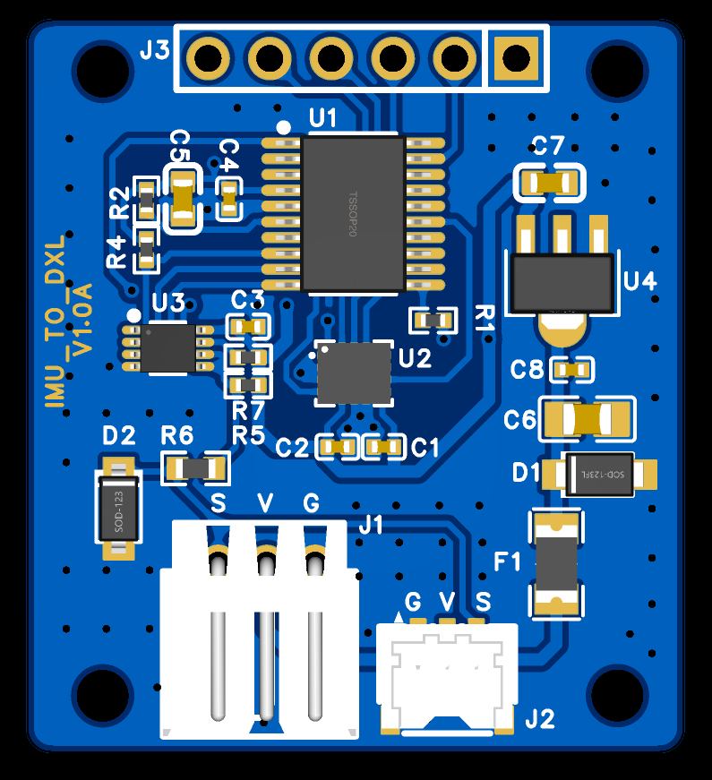
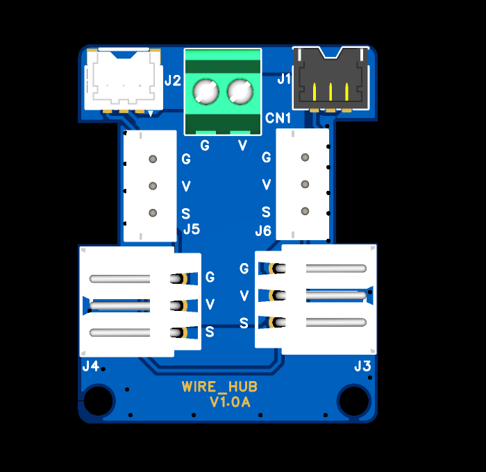
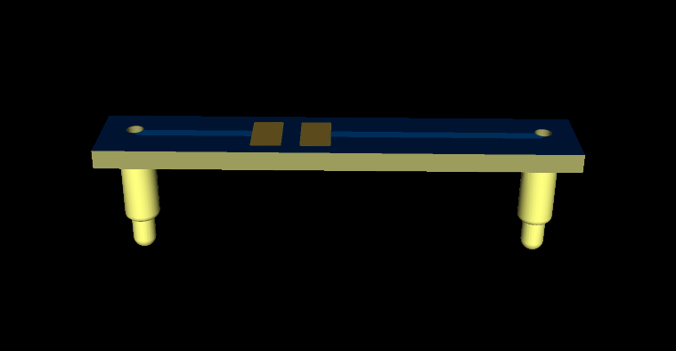
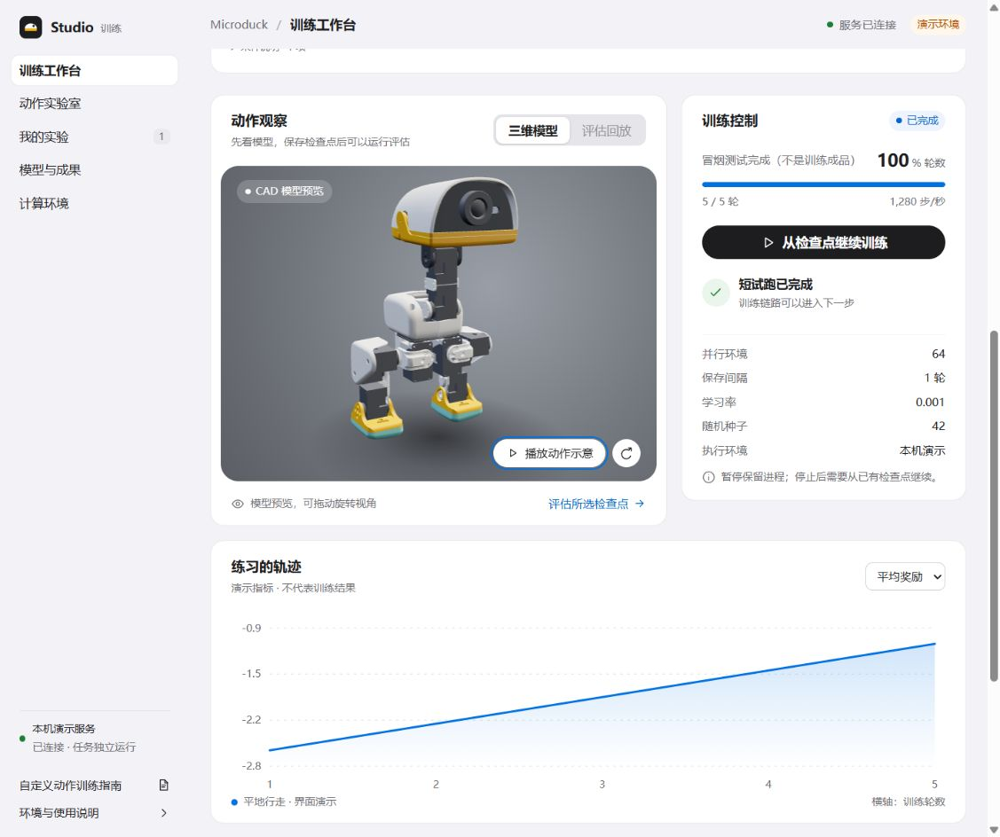

# Microduck Replica

**English** · [简体中文](README.md)

A third-party replica project based on [Pollen Robotics' Microduck](https://pollen-robotics.com/microduck/), with resources for sourcing parts, printing, assembly, calibration, control, and training.

Our main build uses **15 Feetech HD-1910 servos**. We provide a **ready-to-flash system image** and the **Microduck Studio web console** for Wi-Fi setup, calibration, and remote control from a phone or computer browser.

## The ducks in action

**2026-10-24 · Real hardware demos**: two short clips from the latest builds, showing a forward roll followed by standing back up, and walking on a tabletop.

<table>
<tr>
<th align="center">Forward roll and recovery</th>
<th align="center">Tabletop walking</th>
</tr>
<tr>
<td align="center" valign="middle"></td>
<td align="center" valign="middle"></td>
</tr>
<tr>
<td align="center"><a href="assets/demos/2026-10-24-roll-and-rise.mp4">Full MP4 · about 8 seconds</a></td>
<td align="center"><a href="assets/demos/2026-10-24-walking.mp4">Full MP4 · about 6 seconds</a></td>
</tr>
</table>

The GIFs are silent previews; the MP4 files include the complete video and audio.

**[Download the image](https://github.com/fanhao375/microduck-replica/releases/latest)** · **[First-use guide (PDF / web)](docs/上手指南/README.md)** · **[CAD and print files](https://github.com/fanhao375/microduck-replica-cad)** · **[Assembly tutorials](#-assembly-videos)** · **[BOM shopping list](BOM/README.md)** · **[Hardware projects](hardware/README.md)**

---

### Supported builds

- **Feetech HD-1910 + Radxa Zero 3W**: use this repository's system image and Studio web console.
- **Dynamixel XL330**: matching CAD and assembly resources are available; use compatible runtime software.

[Choose print files and shopping list](#print-files-and-shopping-list) · [Detailed servo comparison](docs/actuator-selection.en.md)

---

## Community

A WeChat group for people working on the same thing — build progress, pitfalls, sourcing.

The code below is for **Duck Replica Group 11** (WeChat disables QR joins once a group reaches 200 members).

  
   
  <b>Duck Replica Group 11 · QR code valid before 2026-11-01</b> — WeChat group codes are valid for 7 days 
  If it has expired, open an <a href="https://github.com/fanhao375/microduck-replica/issues">issue</a> and I will post a fresh one

---

## 📺 Assembly videos

**[Bilibili series "MicroDuck 从零安装教程" (assembly from scratch)](https://space.bilibili.com/312747174/lists/9279084?type=season)** — recorded by **机械行者Robo**, who modelled the CAD and wrote the assembly BOM. It starts from the parts list and builds one subassembly per episode. Narration is in Chinese, but the hands-on footage is easy to follow. 6 of 8 episodes are out as of 2026-10-12:

The creator's accounts sit beside the episode list: **Bilibili, Xiaohongshu (RED), then Douyin**. Scan a code or click its image to open the account.

<table>
<thead>
<tr><th>Episode</th><th>Content</th><th nowrap>Length</th><th>Bilibili</th><th>Xiaohongshu</th><th>Douyin</th></tr>
</thead>
<tbody>
<tr>
<td nowrap><a href="https://www.bilibili.com/video/BV1RoHX68EFV/">1</a></td><td width="260"><a href="https://www.bilibili.com/video/BV1RoHX68EFV/">Parts and hardware list</a></td><td nowrap>1:32</td>
<td rowspan="6" align="center" valign="middle" width="210"> <b>机械行者Robo</b> UID 312747174</td>
<td rowspan="6" align="center" valign="middle" width="210"> <b>机械行者</b> ID 270594280</td>
<td rowspan="6" align="center" valign="middle" width="210"> <b>机械行者Robo</b> ID 1852366168</td>
</tr>
<tr><td nowrap><a href="https://www.bilibili.com/video/BV1Xppb6tECr/">2</a></td><td><a href="https://www.bilibili.com/video/BV1Xppb6tECr/">Lower legs</a></td><td nowrap>2:21</td></tr>
<tr><td nowrap><a href="https://www.bilibili.com/video/BV1ycpb6yEwB/">3</a></td><td><a href="https://www.bilibili.com/video/BV1ycpb6yEwB/">Thighs</a></td><td nowrap>5:13</td></tr>
<tr><td nowrap><a href="https://www.bilibili.com/video/BV1Kwpg6wE9G/">4</a></td><td><a href="https://www.bilibili.com/video/BV1Kwpg6wE9G/">Torso</a></td><td nowrap>2:29</td></tr>
<tr><td nowrap><a href="https://www.bilibili.com/video/BV1EEpg6nEkD/">5</a></td><td><a href="https://www.bilibili.com/video/BV1EEpg6nEkD/">Neck</a></td><td nowrap>0:40</td></tr>
<tr><td nowrap><a href="https://www.bilibili.com/video/BV1aKpE6hEzj/">6</a></td><td><a href="https://www.bilibili.com/video/BV1aKpE6hEzj/">Head</a></td><td nowrap>5:50</td></tr>
</tbody>
</table>

### Print files and shopping list

Choose print resources for your servo version, then prepare the matching purchased parts.

| Resource | Servo version | Where to find it |
|---|---|---|
| **Print files and CAD** | **Feetech HD-1910** | [Feetech section](https://github.com/fanhao375/microduck-replica-cad#飞特-hd-1910-打印资料): print project, CAD sources and update notes |
| **Print files and CAD** | **Dynamixel XL330** | [XL330 section](https://github.com/fanhao375/microduck-replica-cad#dynamixel-xl330-打印资料): matching CAD sources and printing instructions |
| **Assembly shopping list** | **Feetech HD-1910** | **[Online preview](BOM/README.md)** · **[Download Excel](BOM/装配BOM-机械行者Robo-2026-10-23-带采购链接.xlsx)**: compiled by 机械行者Robo, dated 2026-10-23, with quantities, materials and purchase links |

Mating parts from the two servo versions are not interchangeable. File versions and update dates are maintained in the respective CAD sections. This shopping list follows the Feetech build; XL330 servos and associated electronics need separate checks.

---

## Where things stand

As of **2026-10-25**. Current progress is grouped below by software, mechanics, electronics, actuator modelling, the training workbench and tools. See [update history](docs/update-history.en.md) for the history.

---

## 💻 Software · system image and Microduck Studio

**Replica image 20261023c is released.** Flash a card, then use a phone or computer browser for Wi-Fi setup, servo and IMU calibration, gamepad control, model management and diagnostic log export.

 Studio interface demonstration with simulated device readings

**[Download the image](https://github.com/fanhao375/microduck-replica/releases/latest)** · **[First-use guide](docs/上手指南/README.md)** · **[Studio documentation](software/studio/README.md)**

The image is free for personal non-commercial builds; see the release for component licences. Camera input defaults to a test source; see the release notes for physical camera and ToF verification limits.

---

## 🔧 Mechanics · one-stop printing and assembly

**机械行者Robo maintains separate Feetech HD-1910 and Dynamixel XL330 resources.** Models, print projects and update notes live in the CAD repository; choose the files matching your servos.

| What you need | Where to find it |
|---|---|
| **One-stop printing** | **[Bambu MakerWorld (Feetech)](https://makerworld.com.cn/zh/models/2963569-microduck#profileId-3478428)** · [Bambu Studio 3MF project](https://github.com/fanhao375/microduck-replica-cad#打印) |
| **Models and print resources** | **[Feetech HD-1910 section](https://github.com/fanhao375/microduck-replica-cad#飞特-hd-1910-打印资料)** · **[XL330 section](https://github.com/fanhao375/microduck-replica-cad#dynamixel-xl330-打印资料)** |
| **Assembly tutorials** | **[Assembly manual PDF](https://github.com/fanhao375/microduck-replica-cad/blob/master/安装说明书/microduck装配安装说明书.pdf)** · **[Episode videos](#-assembly-videos)**; use the matching structural parts for each build |
| **Shopping list** | **[Online BOM preview](BOM/README.md)** · **[Download Excel](BOM/装配BOM-机械行者Robo-2026-10-23-带采购链接.xlsx)**: 2026-10-23 Feetech list; XL330 servos and associated electronics need separate checks |

[CAD repository releases](https://github.com/fanhao375/microduck-replica-cad/releases) · [Build log](BUILD-LOG.en.md)

---

## 🔌 Electronics · three circuit boards

EasyEDA Pro projects and whole-board STEP models are available for the bus IMU board, servo bus hub and battery terminal board. See each project's notes for fabrication, wiring and physical verification status.

<table>
<tr><th>Bus IMU board</th><th>Servo bus hub</th><th>Battery terminal board</th></tr>
<tr>
<td align="center" valign="middle" width="280"></td>
<td align="center" valign="middle" width="280"></td>
<td align="center" valign="middle" width="280"></td>
</tr>
<tr>
<td align="center"><a href="assets/hw/imu-to-dxl-1v0a-pcb.png">PCB preview</a> · <a href="hardware/新版/imu_to_dxl_1V0A/">Project files</a></td>
<td align="center"><a href="assets/hw/wire-hub-1v0a-pcb.png">PCB preview</a> · <a href="hardware/新版/wire_hub_1V0A/">Project files</a></td>
<td align="center"><a href="assets/hw/pogo-pin-1v0a-pcb.png">PCB preview</a> · <a href="hardware/新版/POGO_PIN_1V0A/">Project files</a></td>
</tr>
</table>

3D design previews; click an image to view the original.

[All hardware projects](hardware/README.md) · [Three-board notes](hardware/新版/README.md) · [Bus IMU firmware](hardware/imu_to_dxl/README.md)

---

## 🧠 Actuator modelling · BAM for Feetech HD-1910

The training project already uses a **BAM actuator model for Feetech HD-1910**. The current baseline uses **LuwuDynamics' public 1910 M6 parameters**; see the [parameter notes](docs/HD-1910-M6参数来源.md) for provenance and a comparison with the manufacturer's parameter set.

---

## 🖥️ Open-source training workbench · Microduck Training Studio

We also built **Microduck Training Studio**: create training experiments on a computer, view curves, pause and resume, evaluate checkpoints and export ONNX models through a browser. It runs separately from Studio on the duck.

 Training workbench in demo mode: the 3D view is a model preview and the curves use synthetic data

The real-GPU short-run, evaluation-video and model-export pipeline has been verified. Long training and physical validation of our own trained policies remain pending.

**[Training workbench and usage](software/training-studio/README.md)** · **[Action Lab guide](software/training-studio/web/custom-actions.md)** · **[Training engine](software/training/README.md)** · [Verification record](software/training-studio/docs/verification.md)

---

## 🧰 Tools · flashing, debugging and references

The [tool index](tools/README.en.md) groups utilities by the task you want to perform.

| Task | Tools and links |
|---|---|
| Flash an image | **[Rufus portable EXE](tools/rufus/rufus-4.15p.exe)** · [Flashing guide](tools/rufus/README.md) |
| Serial and servo debugging | **[Feetech FD and serial utilities](tools/飞特/README.md)** · [3D servo web console](tools/servo-web/README.md) |
| Read Feetech references or use an SDK | **[Official manuals, model specifications and SDKs](docs/飞特资料/README.md)**, with official version checks and separate offline snapshot dates |
| Test servos and investigate motion | [HD1910M tester](tools/FeeTech_HD1910M_Servo/README.md) · [STS3215 tester](tools/sts3215Servo_testtool/README.md) · [Gait analysis](tools/gait-analysis/README.md) |

---

## 🦆 Contributions from the flock

This repo is not one person's work. Merged code and bench-verified findings are credited here.

| Who | What they contributed |
|---|---|
| [@yoyojacky](https://github.com/yoyojacky) | **A Rust test tool for Feetech servos** ([PR #27](https://github.com/fanhao375/microduck-replica/pull/27), merged). A minimal STS/SCS protocol implementation of his own (framing, checksum, ping, register read/write, status parsing). The CLI scans the bus with a progress bar, reads status, moves a servo to a position, and runs single or batch tests that report position error, peak current, peak load, voltage and temperature, with a PASS/FAIL verdict — one command gives you a bench acceptance table → [`tools/sts3215Servo_testtool/`](tools/sts3215Servo_testtool/) |
| [@Abo1ish](https://github.com/Abo1ish) | **IMU board firmware + attitude view in the debug console** ([PR #32](https://github.com/fanhao375/microduck-replica/pull/32), merged). A base STM32G031 firmware for the imu_to_dxl board that Pollen never open-sourced, verified on real hardware, with host-side tests and a [`VALIDATION.md`](hardware/imu_to_dxl/firmware/VALIDATION.md) that is clear about its limits → [`hardware/imu_to_dxl/firmware/`](hardware/imu_to_dxl/firmware/). He also streams the IMU attitude over J-Link into the web debug console, so the 3D duck's body turns with the real board (`--imu-jlink`, or `--imu-demo` with no hardware) → [`tools/servo-web/`](tools/servo-web/) |
| A member of the WeChat group | **Boot recipe for the Radxa Zero 3W V1.12J.** On this batch (WiFi changed to AIC8800DS2), swapping in Radxa's bootloader is not enough. He found by testing that the device tree has to come from Radxa too: **B1 bootloader + B1 DTB + Armbian 6.1.115 kernel + Trixie userland**, and got it booting → written up in the [pitfalls log](踩坑记录.md#软件) and the [image guide](tools/radxa/镜像使用说明.md) (both Chinese) |

---

## Projects from the flock

Some people build duck-related things in their own repos. The good ones get a shout-out here:

| Project | Author | What it does |
|---|---|---|
| [microduck-color-studio](https://github.com/LathamZ/microduck-color-studio) ([live demo](https://lathamz.github.io/microduck-color-studio/)) | [@LathamZ](https://github.com/LathamZ) | **A 3D color studio for the duck: settle the colors in your browser before you print.** Color each of the 70 parts, pick a material (PLA / matte / PETG / metallic / carbon fiber / TPU) and lighting to preview. Enter the filaments you already own and it recommends palettes from your stock (use what you have / add one color / acrylic accents). You can also import your own 3MF (e.g. the Feetech version) and export a **colored multi-plate 3MF** plus per-part STLs, with presets for Bambu P1S / A1 mini / H2D. Chinese and English UI, works on mobile |
| [MICDUCK_FTHD1901_REBUILD](https://github.com/fengj4780-sudo/MICDUCK_FTHD1901_REBUILD) | [@fengj4780-sudo](https://github.com/fengj4780-sudo) | **Feetech-build structural rework with optional CNC reinforcement.** Builds on our [editable SolidWorks drawings](https://github.com/fanhao375/microduck-replica-cad): adapted to the Feetech servo (written as HD1901 in that repo; the part files are HD-1910-C001), weak parts reinforced, assembly interferences fixed and some broken models repaired. **Five leg parts can be made as CNC parts** for better load paths (still being prototyped; the author estimates about ¥45 for all five including shipping); printing them instead also works and is stronger than the original. Includes a one-click 3MF (Bambu H2D, 0.4 mm, 5 plates) and the reworked SolidWorks drawings (Chinese) |
| [Microduck-kissqy](https://github.com/kissqy/Microduck-kissqy) | [@kissqy](https://github.com/kissqy) | **A reference for Feetech HD1910 training workflows and robot control.** Includes a training console, environment setup and job management guides, ONNX model export, a robot control console, firmware and demo videos. Recommended in the algorithms section for the practical training workflow |

Built something for the duck (a tool, tutorial, mod, policy…)? Open an issue with the link and we'll add it.

Want to join in: open an [issue](https://github.com/fanhao375/microduck-replica/issues) or send a PR.
Hardware, firmware, algorithms, documentation, measured data — all of it counts. **Measured data especially**: the rule in this repo is that results get recorded honestly, positive or negative.

---

## Documentation

Paths are relative to this repository's root. Mechanical CAD is maintained in a separate repository.

| Project | Repository location | Description and links |
|---|---|---|
| First use and assembly | [CAD repository](https://github.com/fanhao375/microduck-replica-cad) · [BOM/](BOM/README.md) | [First-use guide](docs/上手指南/README.md) · [Shopping list](BOM/README.md) · [Assembly videos](#-assembly-videos) |
| Software and image | [software/](software/README.md) | [Studio](software/studio/README.md) · [Image build](software/image/README.md) |
| Training workbench and project | [software/training-studio/](software/training-studio/README.md) [software/training/](software/training/README.md) | Browser workbench, simulation environment and model export |
| Electronics and firmware | [hardware/](hardware/README.md) | [Board projects](hardware/README.md) · [IMU firmware](hardware/imu_to_dxl/README.md) |
| Debug and analysis tools | [tools/](tools/README.en.md) | [Tool index](tools/README.en.md) · Flashing, serial debugging, Feetech references and analysis |
| Documentation and records | [docs/](docs/README.en.md) | [All documentation](docs/README.en.md) · [Pitfalls](踩坑记录.md) · [Debug log](调试记录.md) · [Build log](BUILD-LOG.en.md) |
| History and community | [docs/](docs/README.en.md#research-and-archives) | [Update history](docs/update-history.en.md) · [Community contributions](docs/community-contributions.en.md) |

---

## Licence and sources

Code, simulation assets and bundled models have separate licences. See [licensing and attribution](NOTICE.md) and the [model terms](software/image/overlay/usr/share/doc/microduck/模型说明.txt); **the replica image is for personal non-commercial builds and must not be distributed with paid products**.

This third-party project is not affiliated with or endorsed by Pollen Robotics.

### ❤️ Support the author

This project has grown through hands-on assembly, debugging, software development and documentation. If the resources and tools have helped you, a Star ⭐, bug report or build story is always welcome. You can also leave a voluntary tip to buy the author a coffee and support continued maintenance. Thank you to everyone helping the duck along.

 Optional support via WeChat · Click the image for full size

